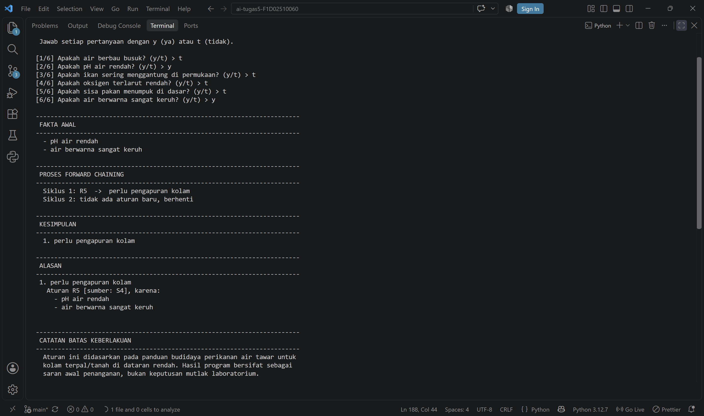
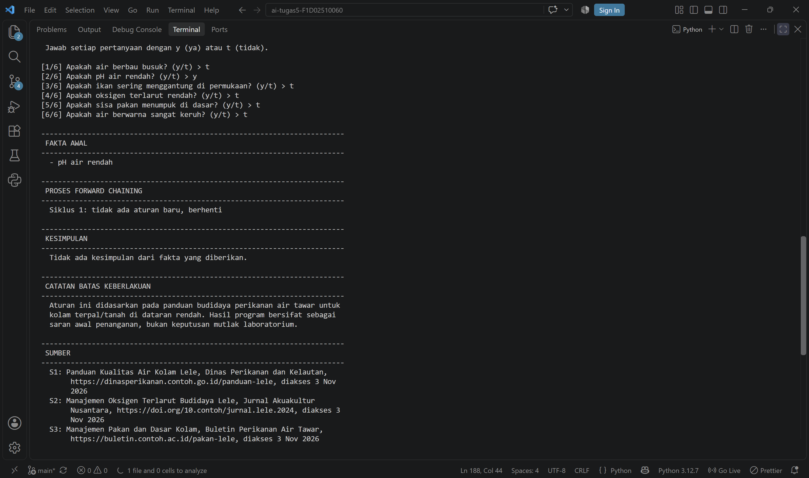
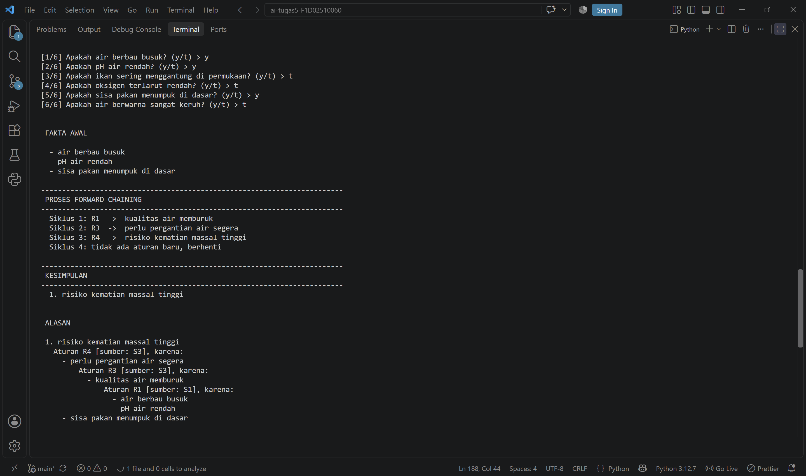

# Tugas 5 — Sistem Pakar Sederhana (Forward Chaining)

## 1. Identitas
* **Nama:** Jihan Rahmadani
* **NIM:** F1D02510060

---

## 2. Topik dan Cara Menjalankan Program
* **Topik:** Diagnosis Masalah Kualitas Air Kolam Lele (berbasis basis pengetahuan file `kb_lele.json`).
* **Bahasa Pemrograman:** Python 3 (menggunakan sintaks dasar dan pustaka standar tanpa library eksternal).
* **Versi Python:** Python 3.8 atau yang lebih baru.
* **Perintah Menjalankan Program:**
  Buka terminal atau command prompt di dalam folder proyek, lalu jalankan perintah berikut:
  ```bash
  python sistem_pakar.py kb_lele.json
  ```

---

## 3. Daftar Sumber dan Tabel Aturan

### Daftar Sumber Referensi
1. **S1:** *Panduan Kualitas Air Kolam Lele*, Dinas Perikanan dan Kelautan, https://dinasperikanan.contoh.go.id/panduan-lele, diakses 3 November 2026.
2. **S2:** *Manajemen Oksigen Terlarut Budidaya Lele*, Jurnal Akuakultur Nusantara, https://doi.org/10.contoh/jurnal.lele.2024, diakses 3 November 2026.
3. **S3:** *Manajemen Pakan dan Dasar Kolam*, Buletin Perikanan Air Tawar, https://buletin.contoh.ac.id/pakan-lele, diakses 3 November 2026.
4. **S4:** *Teknik Pengapuran dan pH Kolam Ikan*, Direktorat Jenderal Perikanan Budidaya, https://djpb.contoh.go.id/pengapuran, diakses 3 November 2026.

### Tabel Aturan (IF-THEN)
| Aturan | Mode | IF (Syarat) | THEN (Kesimpulan / Hasil) | Sumber |
| :--- | :--- | :--- | :--- | :--- |
| **R1** | dan | air berbau busuk AND pH air rendah | kualitas air memburuk | S1 |
| **R2** | dan | ikan sering menggantung di permukaan AND oksigen terlarut rendah | kadar oksigen kritis | S2 |
| **R3** | atau | kadar oksigen kritis OR kualitas air memburuk | perlu pergantian air segera | S3 |
| **R4** | dan | perlu pergantian air segera AND sisa pakan menumpuk di dasar | risiko kematian massal tinggi | S3 |
| **R5** | dan | pH air rendah AND air berwarna sangat keruh | perlu pengapuran kolam | S4 |

---

## 4. Metode yang Dipilih
Metode yang dipilih adalah **Forward Chaining (Pencarian Maju)**. 
* **Alasan:** Metode ini sangat cocok untuk sistem pakar diagnosis berbasis gejala karena pencarian dimulai dari fakta-fakta dasar yang dikumpulkan melalui tanya jawab interaktif dengan pengguna, lalu dicocokkan dengan bagian kondisi (*IF*) dari basis pengetahuan untuk menurunkan kesimpulan baru secara bertahap hingga mencapai konklusi akhir.

---

## 5. Tiga Kasus Uji dan Screenshot

### Kasus Uji 1 (Positif — Menghasilkan Kesimpulan Sederhana)
* **Input Fakta (Ya):** `pH air rendah` dan `air berwarna sangat keruh` (memicu aturan R5).
* **Kesimpulan yang Diharapkan:** `perlu pengapuran kolam`.
* **Screenshot:**
  

### Kasus Uji 2 (Negatif — Tidak Ada Kesimpulan)
* **Input Fakta (Ya):** Hanya menjawab "ya" pada satu fakta dasar yang tidak mencukupi syarat aturan mana pun (misalnya hanya `pH air rendah` saja).
* **Kesimpulan yang Diharapkan:** Tidak ada kesimpulan dari fakta yang diberikan.
* **Screenshot:**
  

### Kasus Uji 3 (Positif Bertingkat — Melibatkan Rantai Aturan)
* **Input Fakta (Ya):** `air berbau busuk`, `pH air rendah`, dan `sisa pakan menumpuk di dasar` (memicu rantai inferensi beruntun dari R1 $\rightarrow$ R3 $\rightarrow$ R4).
* **Kesimpulan yang Diharapkan:** `risiko kematian massal tinggi` beserta pohon pelacakan alasannya.
* **Screenshot:**
  

---

## 6. Batas Keberlakuan
Aturan ini didasarkan pada panduan budidaya perikanan air tawar untuk kolam terpal atau tanah di dataran rendah. Pengetahuan yang digunakan bersumber dari panduan dinas perikanan, jurnal akuakultur, serta buletin resmi perikanan untuk keadaan umum pengelolaan kolam lele intensif. Hasil dari program ini murni bersifat sebagai saran awal penanganan teknis di lapangan, bukan keputusan mutlak laboratorium atau pengganti diagnosis ahli perikanan profesional.

---

## 7. Penggunaan Alat Bantu AI
* Digunakan untuk membantu mengintegrasikan pembacaan file basis pengetahuan berformat JSON (`kb_lele.json`) ke dalam program utama Python, menyusun alur logika pencocokan dan keterhubungan antar-aturan (*rule chaining*) pada mesin *Forward Chaining*.
